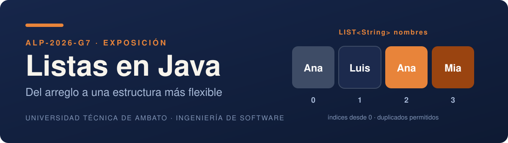
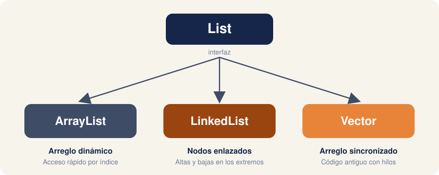

<div align="center">



<br/>


**Exposición de Algoritmos y Lógica de Programación**
*Universidad Técnica de Ambato · Ingeniería de Software*

[👥 Equipo](#-equipo) · [🗺️ Ruta](#️-ruta-de-la-clase) · [📚 Qué es una lista](#-qué-es-una-lista) · [🧩 Tipos](#-tipos-de-listas) · [💻 Código](#-métodos-principales) · [📁 Estructura](#-estructura-del-repositorio)

</div>

---

## 👥 Equipo

| Integrante | Parte que expone |
|---|---|
| **Francisco Bonifaz**  | Parte 1 · Introducción a las listas · 25 min |
| **Dixon Padro** | Parte 2 · Fundamentos y tipos de listas |
| **David Purina** | Parte 3 · Implementación y programación · 36 min |
| **Sebastián Navas**  | Parte 4 · Ejercicio grupal, Kahoot y evaluación final |

📅 **Fecha de presentación:** 27 de noviembre de 2026

---

## 🗺️ Ruta de la clase

1. 🧪 **Diagnóstico:** repaso de arreglos de la semana pasada.
2. 📖 **Introducción:** qué es una lista y para qué sirve.
3. 🧩 **Fundamentos y tipos:** `List`, `ArrayList`, `LinkedList` y `Vector`.
4. 💻 **Práctica:** crear, modificar y recorrer un `ArrayList`.
5. 🎮 **Cierre:** ejercicio grupal, Kahoot y evaluación final.

---

## 📚 Qué es una lista

Una **lista** es una colección ordenada que almacena varios elementos y puede **crecer o reducirse** mientras el programa se ejecuta.

- ✅ Mantiene el orden de inserción
- ✅ Accede a los elementos por **índice** (desde `0`)
- ✅ Permite elementos **duplicados**
- ✅ Agrega, modifica y elimina elementos

### Arreglo vs. lista

| Característica | Arreglo | Lista |
|---|---|---|
| Tamaño | Fijo al crearse | Dinámico |
| Almacena | Primitivos u objetos | Solo objetos (genéricos) |
| Acceso | `nombres[i]` | `nombres.get(i)` |
| Agregar | Asignar en un índice libre | `add(x)` |
| Eliminar | A mano (reorganizar) | `remove(i)` / `remove(x)` |
| Tamaño actual | `length` | `size()` |

<details>
<summary><b>🔎 Mismo problema, dos soluciones</b></summary>

```java
// Con arreglo: tamaño fijo
String[] nombres = new String[3];
nombres[0] = "Juan";
nombres[1] = "Pedro";
nombres[2] = "Ana";
nombres[3] = "Carlos"; // ❌ ArrayIndexOutOfBoundsException

// Con lista: el tamaño se ajusta solo
List<String> lista = new ArrayList<>();
lista.add("Juan");
lista.add("Pedro");
lista.add("Ana");
lista.add("Carlos");   // ✅ sin problema
System.out.println(lista); // [Juan, Pedro, Ana, Carlos]
```

</details>

---

## 🧩 Tipos de listas

<div align="center">

</div>

<br/>

`List` es una **interfaz**: no se crea con `new List()`. Se usa una implementación.

```java
List<String> nombres = new ArrayList<>();
```

| Característica | ArrayList | LinkedList | Vector |
|---|---|---|---|
| Estructura interna | Arreglo dinámico | Lista doblemente enlazada | Arreglo dinámico |
| Acceso por índice | Rápido · O(1) | Lento · O(n) | Rápido · O(1) |
| Agregar / quitar en extremos | Final: eficiente | Ambos extremos: eficiente | Final: eficiente |
| Insertar / quitar en medio | Desplaza elementos | Reenlaza (tras recorrer) | Desplaza elementos |
| Sincronizado | No | No | **Sí** |
| Implementa `Deque` | No | **Sí** | No |

> 💡 **Regla práctica:** empieza con `ArrayList` y cambia solo si una necesidad concreta lo justifica.

### ¿Cuál conviene utilizar?

- 🔍 **Consultas frecuentes por índice** → `ArrayList`
- 🎵 **Muchas altas y bajas en los extremos** (cola, lista de reproducción) → `LinkedList`
- 🔒 **Código antiguo con varios hilos** → `Vector`

---

## 💻 Métodos principales

```java
import java.util.ArrayList;

ArrayList<String> frutas = new ArrayList<>();

frutas.add("Manzana");        // agrega al final
frutas.add("Pera");
frutas.add("Uva");            // [Manzana, Pera, Uva]

frutas.get(0);                // Manzana
frutas.set(1, "Naranja");     // [Manzana, Naranja, Uva]
frutas.remove("Uva");         // [Manzana, Naranja]
frutas.size();                // 2
frutas.contains("Naranja");   // true
frutas.clear();               // []
```

| Método | Qué hace |
|---|---|
| `add()` | Agrega un elemento al final |
| `get()` | Obtiene un elemento por su posición |
| `set()` | Reemplaza el elemento de una posición |
| `remove()` | Elimina por valor o por índice |
| `size()` | Cuenta los elementos |
| `contains()` | Comprueba si un elemento existe |
| `clear()` | Vacía la lista |

### Recorrer una lista

```java
// for con índices
for (int i = 0; i < nombres.size(); i++) {
    System.out.println(nombres.get(i));
}

// for-each (más cómodo para solo leer)
for (String nombre : nombres) {
    System.out.println(nombre);
}
```

<details>
<summary><b>🎯 Reto: lista de números</b></summary>

Crear una lista de enteros, agregar 10, 20 y 30, cambiar 20 por 50, eliminar 10 y contar cuántos quedan.

```java
ArrayList<Integer> numeros = new ArrayList<>();
numeros.add(10);
numeros.add(20);
numeros.add(30);
numeros.set(1, 50);
numeros.remove(Integer.valueOf(10));
System.out.println(numeros.size()); // 2 → [50, 30]
```

</details>

---

## 📁 Estructura del repositorio

```text
ALP-2026-G7
├── 📂 Documentos
│   ├── 📄 Conclusiones.md
│   ├── 📄 Investigacion.md
│   └── 📄 Preguntas.md
├── 📂 Evidencias
├── 📂 Resultados
├── 📂 src
│   ├── ☕ Código 1. EjemploArrayList.java
│   ├── ☕ Código 2. EjemploLinkedList.java
│   ├── ☕ Código 3. EjemploVector.java
│   ├── ☕ Código 4. RecorrerLista.java
│   ├── ☕ Código 5. RetoNumeros.java
│   └── ☕ Código 6. ComparacionListas.java
└── 📄 LÉAME.md
```

---

<div align="center">

**No existe una lista «mejor» para todo: se elige según el uso.**

<sub>ALP-2026-G7 · Universidad Técnica de Ambato</sub>

</div>
